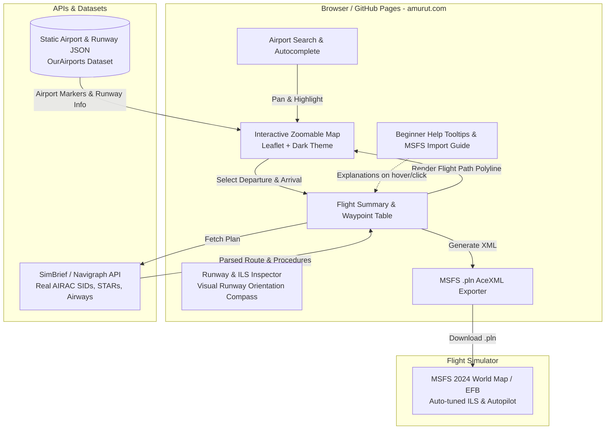

# MSFS 2024 Smart Route Planner — Technical Specification & Implementation Guide

A modern web application tailored for Microsoft Flight Simulator 2024 (and MSFS 2020) that allows flight simmers and aviation beginners to plan routes via an interactive map, inspect detailed runway and airport data, automatically generate AIRAC-compliant SIDs, STARs, and ILS approaches via the SimBrief API, and export a ready-to-fly `.pln` flight plan file.

---

## 1. Executive Summary & Core Requirements

### 1.1 Objective
Provide flight simmers and newcomers with an intuitive, visually stunning EFB-style web app to:
1. **Explore & Select Airports on an Interactive Map:** Pan, zoom, click airport markers, or search by ICAO/IATA/Name.
2. **Inspect Airport & Runway Data:** Display runway designations (e.g., `28L/10R`), length in feet and meters, surface type (Asphalt, Concrete, Turf), elevation, and ILS localizer frequencies/headings.
3. **Automated SID / STAR / ILS Routing (SimBrief Integration):** Ingest real-world AIRAC cycle routes, active runway assignments, departure (SID), arrival (STAR), and approach (ILS) routing via SimBrief's API.
4. **Beginner-Friendly Experience:** Provide inline `(?)` help icons, plain-English tooltips, visual runway compasses, and a step-by-step MSFS 2024 import guide.
5. **Static Deployment to GitHub Pages (`amurut.com`):** Architected as a 100% client-side Single Page Application (SPA) deployable directly to GitHub Pages without mandatory backend servers.

---

## 2. System Architecture



---

## 3. Key Feature Specifications

### 3.1 Interactive & Zoomable Airport Map
* **Map Engine:** Leaflet.js with CartoDB Dark Matter tiles (dark cockpit theme) and smooth zoom/pan.
* **Airport Markers:**
  * Color-coded markers based on airport type (Large International Hubs, Regional, Small GA).
  * Marker clustering at high zoom levels for smooth 60 FPS performance.
* **Airport Selection Interactions:**
  * Clicking an airport marker opens an interactive card showing:
    * **Ident:** ICAO (e.g., `KSFO`) and IATA (e.g., `SFO`).
    * **Name & Location:** San Francisco International Airport, USA.
    * **Elevation:** `+13 ft`.
    * **Runways:** Interactive table of all runways with lengths, magnetic heading, surface, and ILS status.
    * **Actions:** Quick buttons `[Set as Departure]` and `[Set as Arrival]`.

### 3.2 Runway & ILS Inspection Card
For any selected airport, displays a dedicated runway panel:
* **Runway Identifier:** (e.g., `28L`, `28R`, `10L`, `10R`).
* **Visual Compass Widget:** A mini circular compass widget rendering the runway angle visually (so a user immediately grasps why runway 28 points west at ~280°).
* **Dimensions:** Length in feet and meters (e.g., `11,870 ft / 3,618 m`) and width.
* **Surface Type:** Asphalt, Concrete, Grass/Turf, Water.
* **ILS Capabilities:** 
  * Localizer frequency (e.g., `111.70 MHz`).
  * Inbound localizer course (e.g., `284°`).
  * ILS Identifier (e.g., `I-SFO`).
  * Glideslope angle (typically `3.00°`).

### 3.3 Beginner-Friendly UX & "Aviation Explainer" System
Aviation is filled with intimidating acronyms. The UI includes built-in guidance to make it enjoyable for absolute beginners:
* **Interactive `(?)` Help Icons & Tooltips:**
  * **ICAO vs IATA:** *"ICAO (4 letters, e.g., KSFO) is used by pilots and air traffic control. IATA (3 letters, e.g., SFO) is the code you see on airline luggage tags."*
  * **SID (Standard Instrument Departure):** *"Think of a SID as the highway on-ramp for your airplane after takeoff. It keeps planes safely separated from terrain and other traffic."*
  * **STAR (Standard Terminal Arrival Route):** *"The highway off-ramp connecting high-altitude airways down to the airport."*
  * **ILS (Instrument Landing System):** *"A radio beacon at the runway that guides your aircraft down a precise visual and electronic glide path for landing."*
  * **Runway Numbers (e.g. 09 vs 27):** *"Runway numbers indicate their magnetic heading rounded to the nearest 10 degrees (Runway 09 faces East at 090°; Runway 27 faces West at 270°)."*
* **"How to Load into MSFS 2024" Modal:**
  * Step 1: Click the **"Export MSFS 2024 (.pln)"** button to download the file.
  * Step 2: Open MSFS 2024 $\rightarrow$ Go to **World Map** $\rightarrow$ Click **More / Load/Save** (or press Spacebar).
  * Step 3: Select the downloaded `.pln` file.
  * Step 4: Your departure, arrival, runways, cruising altitude, and autopilot waypoints are instantly configured!

### 3.4 SimBrief Route & NavData Engine (Approach A)
* **Integration Mechanism:**
  * Uses the SimBrief XML/JSON Fetcher API (`https://www.simbrief.com/api/xml.fetcher.php`).
  * Users can enter their free SimBrief username or use curated popular city-pair presets.
* **Extracted Data:**
  * **Assigned Departure Runway & SID:** (e.g., Runway `28L`, SID `TRUKN2`).
  * **En-Route Airways & Fixes:** (e.g., `TRUKN2 SYRAH Q120 OAL KANUS GRNPA1`).
  * **Assigned Arrival Runway & STAR:** (e.g., Runway `26L`, STAR `GRNPA1`).
  * **Planned Approach:** (e.g., `ILS 26L`).
  * **Cruise Altitude & Fuel:** Recommended flight level (e.g., `FL350`) and block fuel.

### 3.5 MSFS 2024 `.pln` Exporter
The app dynamically constructs an MSFS-compliant AceXML file:
* **Coordinate Conversion:** Converts decimal latitude/longitude (`37.618999`, `-122.375000`) into MSFS DMS format (`N37° 37' 08.40",W122° 22' 30.00",+000013.00`).
* **Procedure Mapping:**
  ```xml
  <DepartureID>KSFO</DepartureID>
  <DepartureFP>TRUKN2</DepartureFP>
  <DeparturePosition>28L</DeparturePosition>
  
  <DestinationID>KLAS</DestinationID>
  <ArrivalFP>GRNPA1</ArrivalFP>
  <ApproachType>ILS</ApproachType>
  <ApproachNumber>26</ApproachNumber>
  <ApproachDesignator>LEFT</ApproachDesignator>
  <ApproachFP>ILS 26L</ApproachFP>
  ```
* **Full Waypoint Sequence:** Embeds all airway intersections, VORs, and NDBs along the route.
* **Browser Download:** Instantly triggers download as `<DepartureICAO>_<DestinationICAO>_MSFS2024.pln`.

---

## 4. Deployment Architecture: GitHub Pages (`amurut.com`) vs Render

### Can this be deployed on GitHub Pages (`amurut.com`)?
**YES, 100%!** In fact, GitHub Pages is the **best choice** for this application:

| Factor | GitHub Pages (`amurut.com`) | Render.com (Free Tier) |
| :--- | :--- | :--- |
| **Architecture** | Static Single Page App (SPA) | Node.js / Docker container |
| **Cost** | 100% Free forever | Free tier available |
| **Performance & Cold Starts** | **Instant 0ms latency** (global CDN) | Spins down after 15m $\rightarrow$ **50-second cold start** |
| **Custom Domain** | Seamlessly connects to `amurut.com` or `amurut.com/msfs-planner` | Custom subdomain setup required |
| **Maintenance** | Zero server maintenance, automated GitHub Actions build | Server process management required |

### How It Works Without a Backend:
1. **Airport & Runway Data:** Bundled as static optimized JSON or loaded on-demand via fetch chunks.
2. **XML Generation:** Built entirely in the browser using JavaScript and downloaded via standard DOM `Blob` APIs.
3. **Map Tiles:** Streamed directly from CartoDB / OpenStreetMap public CDNs.
4. **CORS Handling for SimBrief:**
   * SimBrief's public API supports direct browser JSON fetch requests.
   * If cross-origin restrictions apply in certain browsers, a free, zero-config Cloudflare Worker or client-side proxy can be used.

---

## 5. Recommended Technology Stack

| Layer | Recommended Technology | Reason |
| :--- | :--- | :--- |
| **Framework** | **React (Vite) + TypeScript** | Blazingly fast build, type safety for complex aviation schemas. |
| **Styling** | **Tailwind CSS + Lucide Icons** | Modern dark cockpit aesthetic with sleek tooltips and modals. |
| **Map Rendering** | **Leaflet + React-Leaflet** | Lightweight, high performance, mobile & desktop responsive. |
| **Airport & Runway Data** | **OurAirports Dataset (Static JSON)** | 40,000+ airports, runway lengths, surfaces, and frequencies. |
| **Routing Engine** | **SimBrief REST API** | Accurate AIRAC SIDs, STARs, and ILS approaches. |
| **Deployment** | **GitHub Actions $\rightarrow$ GitHub Pages** | Automated CI/CD pushing directly to your `amurut.com` site. |

---

## 6. Implementation Roadmap for Antigravity IDE

* **Phase 1: Project Setup & GitHub Pages CI/CD:** Initialize Vite + React + Tailwind, configure `base` path for `amurut.com`, and set up GitHub Actions workflow (`deploy.yml`).
* **Phase 2: Airport Database & Interactive Map:** Load airport markers, clustering, click-to-select, and search bar.
* **Phase 3: Runway Inspector & Beginner Tooltips:** Build the runway details card, visual compass widget, and `(?)` aviation jargon tooltips.
* **Phase 4: SimBrief Route Fetcher:** Implement the API connector to pull active SIDs, STARs, airways, and ILS runway approaches.
* **Phase 5: MSFS 2024 `.pln` Exporter & Tutorial Modal:** Build the AceXML generator, download trigger, and the "How to Load into MSFS 2024" step-by-step visual guide.
